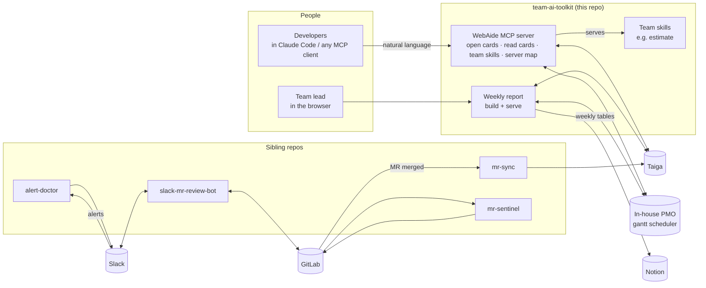

# team-ai-toolkit

**The AI layer I built on top of my team's daily tools: Taiga, an in-house scheduling system, Notion, Slack and GitLab. Developers and leads ask for things in plain language instead of clicking through several systems that don't agree with each other.**

This repository is a **reference implementation, not a turnkey product**. The code is the real code my team runs, with company-specific details removed. Every external system is reached through a small, clearly marked integration point, so you can swap a node for your own tools.

---

## The problem

My web team tracks work in two systems at once:

- **Taiga** holds the requirement cards: specs, comments, QA status.
- **An in-house gantt/scheduling system ("PMO")** holds who does what and when. It is what management looks at. It works, but it is slow and painful to use.

On top of that, the weekly report lived in **Notion**, alerts arrived in **Slack**, and code lived in **GitLab**. Day to day, this caused:

| Pain | What it cost |
|---|---|
| Opening one requirement meant 4 cards in 2 systems: a Taiga US, a PMO parent card, a dev sub-card and a QA sub-card, all linked by hand | Tedious clicking, duplicate cards, and missing links |
| PMO and Taiga statuses drifted apart | Managers saw "in progress" for work that QA had already approved, or the reverse |
| The weekly report was filled into Notion by hand from the PMO gantt | Repetitive manual work for the lead every week, with numbers already stale when published |
| Estimates were argued case by case | No shared method, so the same task got wildly different numbers depending on who estimated it |
| "Is 192.0.2.10 prod or UAT?" | Asked in chat again and again; the answer lived in someone's head |

## What I built



### 1. WebAide MCP: one conversation instead of four systems ([`webaide-mcp/`](webaide-mcp/server.py))

An [MCP](https://modelcontextprotocol.io) server that every developer adds to their AI client. It is deployed once for the team.

| Tool | What it replaces |
|---|---|
| `open_card` | Creating a Taiga US, a PMO parent card, a `開發-…` dev sub-card and a `測試-開發-…` QA sub-card, all cross-linked, in one call |
| `read_taiga_card` | Opening Taiga to read the spec, comments, attachments and sub-tasks before starting work or estimating |
| `search_card` | "Has anyone already opened a card for this?" |
| `list_skills` / `get_skill` | **Team skills served from the server**: everyone's AI follows the same method, such as the estimate skill below |
| `lookup_server` | "Which service is this IP, and is it prod or UAT?" A small editable web page (`/servers`) backs it |
| `list_members`, `version` | Resolving nicknames to scheduler accounts; changelog |

Design decisions worth noting:

- **Preview, then commit.** `open_card` with `confirm=false` returns exactly what will be created, plus any similar existing cards. The model has to show the preview to the user before calling again with `confirm=true`. Exact duplicates are blocked unless the user explicitly overrides.
- **Personal token for identity, shared bot for writes.** Each developer's bearer token only identifies *who* is asking. All writes go through one bot account, and every card records "created by X via WebAide". No developer credentials are stored on the server.
- **Partial failure is reported, never retried.** If card 3 of 4 fails, the tool returns `created_so_far` and tells the model *not* to retry. A retry would create duplicates.
- **Schedules respect reality.** Dates must be workdays, checked against weekends and the national holiday list. The UAT date can't be earlier than the start date, and the tool warns when the holiday list doesn't cover the year.
- **The server's instructions are a routing table.** `RULES` maps what users actually say ("開卡", "估時", "這台是正式還測試") to tools, so the model picks the right one without the user knowing tool names.
- **Optimistic concurrency on the shared server map.** Every entry carries a `rev`, so one person's edit can't silently overwrite another's.

### 2. Weekly report: the scheduler, made readable and kept honest ([`weekly-report/`](weekly-report/))

`build.py` pulls every task from the scheduler and renders **one self-contained HTML file**. It opens from `file://`, from any static host, or from the bundled server.

- **Four-week view per person** (last week / this week / next 2 weeks), using time-window overlap rather than due dates.
- **Parent/child roll-up.** One requirement with many sub-cards becomes one row. Its status is the *least advanced* sub-card, and stale container statuses are ignored. When in doubt, it under-reports rather than over-reports.
- **Done means handed to QA.** That is how the team defines finished, so the page uses the same definition.
- **Cross-checks against Taiga** (`taiga.py`). Rows where the two systems disagree by two or more stages are flagged.
- **Self-healing on every rebuild.**
  - When Taiga is clearly ahead, the scheduler card's status is pushed forward and a comment explains why.
  - Links to Taiga cards that return a definite 404 are removed. If more than a threshold of links "disappear" at once, nothing is removed, because that looks like a Taiga outage rather than real deletions.
  - The tool only ever moves statuses forward, and never touches parent or paused cards.

`serve.py` turns the static page into a small team app:

- Edit scheduler or Taiga status from a drawer on the page. The browser never holds API keys. The server proxies a **whitelist** of routes and does not follow redirects.
- The lead can reorder each person's priorities, manage the roster (validated against both the scheduler and Taiga), and generate the **Notion weekly-report tables** for copy-paste.
- A server-side cooldown on "rebuild now", so reloading the page or opening more tabs can't get around it.

`weekly.py` is the original CLI: a terminal weekly report, plus Notion-flavoured Markdown for an AI to write into that week's Notion page through Notion's MCP.

### 3. Team skills ([`skills/estimate/`](skills/estimate/SKILL.md))

A skill is a Markdown playbook the AI follows. `estimate` is our method for **estimating software work when AI writes most of the code**. Its main points:

- **Price the review loop, not the typing.** Building collapsed to under 10% of total cost in our measurements.
- **Separate effort from elapsed time.** Report a net number with its assumptions attached.
- **Additive change vs. real refactor.** Misjudging which one a task is caused systematic 3× over-estimates.

It is calibrated on real projects from my team; see `references/calibration.md`. Because WebAide serves it through `get_skill`, every developer's AI estimates the same way.

### 4. The rest of the graph lives in sibling repos

| Repo | Node | What it does |
|---|---|---|
| [mr-sync](https://github.com/kavinqq/mr-sync) | GitLab → Taiga | When an MR merges into the test branch, the linked Taiga card moves to *Ready for test* |
| [alert-doctor](https://github.com/kavinqq/alert-doctor) | Slack | Triages every monitoring alert and posts verified LLM root-cause analysis |
| [mr-sentinel](https://github.com/kavinqq/mr-sentinel) | GitLab | Self-hosted AI code review with an adversarial second model |
| [slack-mr-review-bot](https://github.com/kavinqq/slack-mr-review-bot) | Slack ↔ GitLab | Tag the bot in Slack to review a branch or ask questions about a codebase |

---

## Swapping a node

Each external system is reached through a few functions. To use your own tools, replace these:

| Node | Used for | Integration points |
|---|---|---|
| **Task tracker** (Taiga) | Requirement cards, statuses, comments | `webaide-mcp/server.py`: `taiga()`, `_find_taiga()`, `read_taiga_card`<br/>`weekly-report/taiga.py`: `Taiga._req()`, `Taiga.card()`, `TAIGA_RANK` (status → stage) |
| **Scheduler** (in-house PMO) | Assignments, dates, the management view | `webaide-mcp/server.py`: `pmo()`, `pmo_tasks()`, `pmo_members()`, `open_card` → `create()`<br/>`weekly-report/weekly.py`: `api()`, `connect()`, `load_all_tasks()`, `team_status()` (status → stage) |
| **Docs** (Notion) | Weekly report page | `weekly-report/weekly.py`: `build_notion_content()`<br/>`weekly-report/serve.py`: `notion_tables()`, `POST /api/admin/notion` |
| **Chat** (Slack) | Alerts, review requests | alert-doctor, slack-mr-review-bot |
| **Git host** (GitLab) | MR events, code review | mr-sync, mr-sentinel |
| **AI client** | Where developers talk to WebAide | Any MCP client: Claude Code, Claude Desktop, Cursor, … |

The two "status → stage" tables are the key to swapping. Both systems are mapped onto one shared scale:

| Stage | Meaning |
|---|---|
| 0 | to do |
| 1 | in progress |
| 2 | blocked |
| 3 | handed to QA |
| 4 | ready to release |
| 5 | done |

Cross-checks and auto-alignment only compare stages, so a new tracker only needs its own mapping table.

### Running the pieces

```bash
# WebAide MCP (Python 3.11+)
pip install "mcp==2.3.0" "uvicorn==0.54.0" "pydantic==2.14.0"
mkdir -p webaide-mcp/etc && echo '{"tokens": {"<random-token>": "<scheduler user name>"}}' > webaide-mcp/etc/users.json
export PMO_BASE=https://pmo.example.com PMO_API_KEY=...
export TAIGA_BASE=https://taiga.example.com TAIGA_HOOK_USER=... TAIGA_HOOK_PASSWORD=...
python webaide-mcp/server.py           # MCP endpoint: http://127.0.0.1:8103/mcp

# Weekly report (standard library only)
# Credentials are read from the macOS Keychain: see get_credentials() in weekly.py and Taiga.connect() in taiga.py
cp weekly-report/people.example.json weekly-report/people.json
python weekly-report/build.py --open
python weekly-report/serve.py --port 8099
```

Both tools expect APIs shaped like Taiga's REST API and our scheduler's API. Read the integration points above before pointing them at something else.

---

## Notes

- Strings shown to users, prompts and code comments are in Traditional Chinese, because the team is Taiwanese.
- Hostnames, people and project names are placeholders.

## License

[MIT](LICENSE) © 2026 KuanLin
